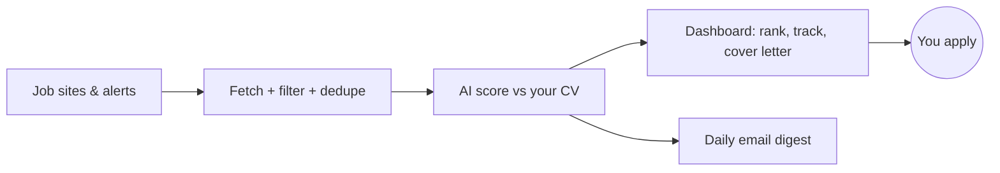

# JobPilot

**Your personal job-search assistant.** JobPilot collects jobs from many sites, ranks them against
your CV with free AI, drafts cover letters, tracks your applications and emails you the best new
matches every morning.

> **JobPilot never applies for you.** It finds, ranks and prepares. You review and apply yourself.

Everything runs on your own computer. It's free: free job sources, Google Gemini's free tier, and
Gmail.

---

## Contents
- [What it does](#what-it-does)
- [What you need](#what-you-need)
- [Install (about 5 minutes)](#install-about-5-minutes)
- [First run: set up in the browser](#first-run-set-up-in-the-browser)
- [Everyday use](#everyday-use)
- [Run it automatically every morning](#run-it-automatically-every-morning)
- [Customize your search](#customize-your-search)
- [Optional: LinkedIn and Indeed job alerts](#optional-linkedin-and-indeed-job-alerts)
- [Command line (optional)](#command-line-optional)
- [Privacy and safety](#privacy-and-safety)
- [Troubleshooting](#troubleshooting)
- [For developers](#for-developers)

---

## What it does

| Feature | What you get |
|---|---|
| **Collects jobs** | Remotive, RemoteOK, Arbeitnow, We Work Remotely, and company career boards on Greenhouse and Lever (GitLab, Canonical, Grafana Labs, Toptal by default). About 1,300 jobs per run. |
| **Filters and removes duplicates** | Keeps jobs matching your roles and locations, drops region-locked roles ("US only"), and stores the same job from two sites only once. |
| **AI match score** | Gemini rates every job 0–100 against your CV, with a one-line reason. It knows where you're based, so jobs you can't take score low. |
| **Dashboard** | Best matches first, filters (source, keyword, location, minimum score), full job details, a link to apply. |
| **Application tracker** | Status per job (Saved → Applied → Interview → Offer / Rejected), notes and dates, grouped in a Tracker tab. |
| **Cover letter drafts** | One click writes a draft from your CV only, flags `[placeholders]` to fill and any numbers not in your CV. You edit and send it. |
| **Daily email digest** | Your top new matches by email. Never the same job twice. |
| **Runs every morning** | Windows Task Scheduler runs fetch → score → email for you. |
| **Settings in the browser** | Add your Gemini key, CV (PDF/TXT/MD) and Gmail in the app, each with a test button. |
| **Job-alert emails (optional)** | Reads your LinkedIn and Indeed job-alert emails from Gmail, read-only. No scraping. |



---

## What you need
- **Windows 10 or 11** with PowerShell (other systems work too; adjust the commands).
- **Python 3.12**. No Python? Run `py install 3.12`, or install it from python.org.
- **Git**, to download JobPilot.
- **A free Google Gemini API key**, for scores and cover letters. No credit card needed.
- **Optional:** a Gmail account, for the daily email.

---

## Install (about 5 minutes)

Open **PowerShell** and run:

```powershell
git clone https://github.com/IamBishal29/job-scout-ai.git jobpilot
cd jobpilot
py -3.12 -m venv .venv
.venv\Scripts\python -m pip install -e ".[dev]"
```

Start the app:

```powershell
.venv\Scripts\streamlit run app.py
```

Your browser opens **http://localhost:8501**. To stop the app, press **Ctrl+C** in PowerShell.

> Tip: run `.venv\Scripts\Activate.ps1` once per PowerShell window and you can type just
> `streamlit run app.py` and `python -m jobpilot ...`. If PowerShell says *"running scripts is
> disabled"*, run `Set-ExecutionPolicy -Scope CurrentUser RemoteSigned` once.

---

## First run: set up in the browser

The app has four tabs: **Jobs**, **Tracker**, **Run** and **Settings**. Start with **Settings**.

### 1. Settings tab
1. **Gemini API key**
   - Go to **https://aistudio.google.com** → **Get API key** → create a key (free, no card).
   - Paste it, click **Save key**, then **Test key**. You should see *"It works."*
2. **Your CV**
   - Upload your CV as **PDF**, **TXT** or **MD**.
   - Check the extracted text in the box, fix anything odd, and click **Save CV**.
   - Scanned PDFs (images) have no text. Export a text PDF from Word or Google Docs instead.
3. **Gmail** (optional, for the daily email)
   - Turn on **2-Step Verification** for your Google account.
   - Open **myaccount.google.com/apppasswords**, create one called "JobPilot", and copy the 16 letters.
   - Enter your Gmail address, the app password and where to send the digest. Click
     **Save Gmail settings**, then **Send test email**.

### 2. Run tab
1. **Fetch jobs**: about a minute.
2. **Score jobs**: start with 20. Each job takes about 6 seconds (free-tier speed limit), with a
   progress bar.
3. **Preview digest** shows the email. **Send digest** sends it.

### 3. Jobs tab
- The best matches are at the top, each with a **Score** bar and a **Why** reason.
- Use the sidebar to filter: keyword (e.g. `.NET`, `LLM`), source, location, **Min match score**.
- **Click a row** to see:
  - **Match** score and reason
  - **Open job posting**: apply on the company's site
  - **Status** + **Notes** → **Save** (it appears in the **Tracker** tab)
  - **Cover letter draft** → **Generate draft** → edit → **Save edits** → copy it from the box

---

## Everyday use
1. Open the app: `.venv\Scripts\streamlit run app.py`.
2. **Run** → **Fetch jobs** → **Score jobs** (or let the scheduler do it, below).
3. **Jobs** → set **Min match score** to around 60 → review the top matches.
4. Interesting? Set the status to **Saved**, draft a cover letter, open the posting and apply, then set
   **Applied**.
5. **Tracker** shows where every application stands.

---

## Run it automatically every morning

Fetch, score and email the digest daily at 08:00 (only while you're logged in):

```powershell
powershell -ExecutionPolicy Bypass -File scripts\register-task.ps1 -At 08:00
Start-ScheduledTask -TaskName JobPilotDaily        # run once now to test
Get-Content data\logs\daily-*.log -Tail 30         # see what happened
```

- **Change the time:** run the first line again with a different `-At`.
- **Remove it:** `Unregister-ScheduledTask -TaskName JobPilotDaily -Confirm:$false`
- **Missed runs:** if the PC was asleep at 08:00, the task runs when it wakes up.
- **Failures:** each step runs even if an earlier one failed. Logs are in `data\logs\`.

---

## Customize your search

Edit **`config.toml`** in Notepad. The most useful settings:

| Section | Setting | What it does |
|---|---|---|
| `[search]` | `role_keywords` | A job is kept if its title contains one of these (`.net`, `llm`, `tech lead`, ...) |
| `[search]` | `locations` | ...and its location contains one of these (`remote`, `worldwide`, `dhaka`, ...) |
| `[search]` | `exclude_locations` | ...unless it says `us only`, `europe only`, ... |
| `[sources]` | `enabled` | Which sources to use. Add `"alerts"` for LinkedIn and Indeed alert emails. |
| `[boards]` | `greenhouse`, `lever` | Companies to watch. Use the name from their careers URL (`job-boards.greenhouse.io/<name>`). |
| `[profile]` | `based_in` | Where you work from. The AI marks down jobs you can't take from there. |
| `[llm]` | `model`, `requests_per_minute` | Gemini model and pacing. Keep pacing low on the free tier. |
| `[digest]` | `top_n`, `min_score` | How many jobs the email has, and the minimum score to include. |

Save the file and refresh the browser page: the app reads `config.toml` on every click.

---

## Optional: LinkedIn and Indeed job alerts

JobPilot can read the job-alert emails LinkedIn and Indeed send you. It only reads your own email,
read-only, and never scrapes their sites.

1. Create job alerts on LinkedIn or Indeed as usual.
2. In Gmail: **Settings → Forwarding and POP/IMAP → Enable IMAP**.
3. Create a Gmail filter: from `jobalerts-noreply@linkedin.com` OR `alert@indeed.com` → **Apply label**
   `JobAlerts`.
4. In `config.toml`, add `"alerts"` to `[sources] enabled`.
5. **Run → Fetch jobs.** Alert jobs appear with source `alerts`.

It uses the same Gmail app password as the digest. The parser was built from sample emails, so if
company or location come out wrong, open an issue with an example.

---

## Command line (optional)

Everything in the **Run** tab also works from PowerShell:

| Command | What it does |
|---|---|
| `python -m jobpilot fetch` | Collect new jobs |
| `python -m jobpilot score --limit 20` | Score up to 20 new jobs against your CV |
| `python -m jobpilot digest --dry-run` | Show the email without sending |
| `python -m jobpilot digest` | Send the email |
| `python -m jobpilot daily` | fetch → score → digest (what the scheduler runs) |
| `python -m jobpilot llm-check` | Check your Gemini key works |

Run these from the project folder with the virtual environment active, or use
`.venv\Scripts\python -m jobpilot ...`.

---

## Privacy and safety
- **Your data stays on your computer**: jobs, tracker, CV and settings live in the project folder.
- **What's sent to Google:** your CV text and job descriptions go to Gemini when scoring and drafting.
  On the free tier Google may use prompts to improve its models, so leave your phone number and
  address out of the CV.
- **Secrets** (Gemini key, Gmail app password) are saved in `.env`. It's never committed to git and
  never shown back in the app.
- **This computer only:** the dashboard is reachable only from your own computer, not from other
  devices on your Wi-Fi.
- **Polite to job sites:** only public APIs, feeds, or your own emails. We don't scrape sites that
  forbid it (see [ADR 0003](docs/decisions/0003-no-bdjobs-scraper.md) on Bdjobs).
- **Never applies or sends anything on its own**, except the digest email to you.

---

## Troubleshooting

| Problem | Fix |
|---|---|
| *"running scripts is disabled"* | `Set-ExecutionPolicy -Scope CurrentUser RemoteSigned`, or use `.venv\Scripts\python ...` directly |
| **Test key** fails | Re-copy the key from aistudio.google.com. *Quota* errors mean the free daily limit was reached; try tomorrow. |
| *"App password should be 16 letters"* | You pasted your normal Gmail password. Create an app password (Settings → Gmail → how-to). |
| Test email not arriving | Check spam. Make sure 2-Step Verification is on. Create a new app password. |
| *"Almost no text found"* when uploading a CV | It's a scanned PDF. Export a text-based PDF, or upload a `.txt`. |
| Score / Why columns are empty | Run **Run → Score jobs**. It scores up to the batch size each time. |
| Few or no jobs | Widen `role_keywords` / `locations` in `config.toml`, then **Fetch jobs** again. |
| Digest says "Nothing new" | No new jobs scored at or above `[digest] min_score` (60) since the last email. |
| Page won't open | Make sure `streamlit run app.py` is still running, and open http://localhost:8501. |

---

## For developers

```powershell
pytest                      # run tests
ruff check .                # lint
ruff format --check .       # formatting
```

| Path | What's there |
|---|---|
| `app.py` | Streamlit dashboard (Jobs, Tracker, Run, Settings tabs) |
| `src/jobpilot/sources/` | One fetcher per job source |
| `src/jobpilot/actions.py` | Fetch / score / digest, shared by the CLI and the UI |
| `src/jobpilot/matcher.py`, `cover_letter.py` | AI scoring and cover letters |
| `src/jobpilot/db.py` | SQLite storage and migrations |
| `config.toml` | Your search settings |
| `docs/` | [PRD](docs/PRD.md), [Architecture](docs/ARCHITECTURE.md), [Decisions (ADRs)](docs/decisions/), [Learning notes](docs/learning/) |

Built with Python 3.12, Streamlit, SQLite, httpx, pypdf and Google Gemini. Free tools only.
