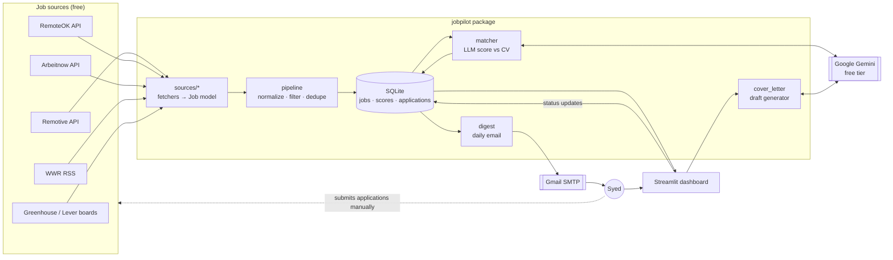

# JobPilot — Architecture

A single local Python app: one package, one SQLite file, one Streamlit UI.
No servers, queues or microservices.

## Components
| Module | Responsibility | .NET analogy |
|---|---|---|
| `jobpilot/models.py` | `Job`, `Application` dataclasses | POCO / record types |
| `jobpilot/sources/` | One fetcher per source, all return `list[Job]` | `IJobSource` implementations |
| `jobpilot/pipeline.py` | normalize, keyword/location filter, dedupe (hash of company+title+url) | service layer |
| `jobpilot/db.py` | SQLite access via stdlib `sqlite3` | repository / Dapper |
| `jobpilot/llm.py` | Thin wrapper around Gemini; one place to swap providers | `ILlmClient` |
| `jobpilot/matcher.py` | Prompt + parse score/reason, cache by job id | domain service |
| `jobpilot/cover_letter.py` | Draft generator | domain service |
| `jobpilot/digest.py` | Build and send daily email | hosted job / Hangfire task |
| `app.py` | Streamlit UI | Blazor Server pages |
| `jobpilot/cli.py` | `python -m jobpilot fetch` etc. | console app entry point |

## Data flow
1. `fetch` (manual or Windows Task Scheduler) → fetchers → pipeline → `jobs` table.
2. `score` → new jobs without a score → Gemini → `scores` table.
3. Dashboard reads jobs + scores and writes status changes to `applications`.
4. `digest` → top-N new scored jobs → email.

## Config & secrets
- `config.toml`: role keywords, locations, source list, company boards (committed).
- `.env`: `GEMINI_API_KEY`, `SMTP_USER`, `SMTP_APP_PASSWORD`, `DIGEST_TO` (never committed).
- `cv.md`: your CV in plain text (git-ignored; personal data).
