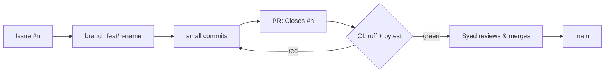

# 00 — How we work: issues, branches, PRs, CI, ADRs

## The concept in plain words
- **Issue**: one small, clear piece of work with acceptance criteria. Like a ticket in Azure Boards or Jira.
- **Milestone**: a group of issues that together deliver something usable (e.g. "M1 Fetch & Store").
- **Branch**: a private copy of the code for one issue (`feat/3-remotive-fetcher`). `main` is always working code.
- **Pull Request (PR)**: a request to merge a branch into `main`. Small PRs (~100–200 lines)
  are quick to review and rarely hide bugs. "Closes #3" auto-closes the issue on merge.
- **CI (GitHub Actions)**: a robot that runs `ruff` (lint/format) and `pytest` on every PR.
  A red check means don't merge.
- **ADR (Architecture Decision Record)**: a short note on *why* we chose something, so
  future-you doesn't re-argue it. Stored in `docs/decisions/`.
- **Conventional Commits**: `feat:`, `fix:`, `docs:`, `test:`, `chore:` prefixes make history readable.

## Why we use it here
Even as a solo project, this flow gives a reviewable history, a safety net (CI), and a
habit that transfers directly to team jobs, and to working with an AI pair-programmer
whose changes you must review.

## .NET equivalent
| Here | .NET world |
|---|---|
| GitHub Issues + milestones | Azure Boards work items + iterations |
| GitHub Actions `ci.yml` | Azure Pipelines YAML running `dotnet build` / `dotnet test` |
| `ruff` | Roslyn analyzers + `dotnet format` |
| `pytest` | xUnit / NUnit |
| `pyproject.toml` | `.csproj` + `Directory.Build.props` |
| `.venv` | per-project NuGet restore (isolated dependencies) |
| `.env` | User Secrets / `appsettings.Development.json` (not committed) |

## Self-check
1. Why do we never commit directly to `main`?
2. What would you write in an ADR vs. in a PR description?
3. CI is green but the feature is wrong. What else catches that before merge?
