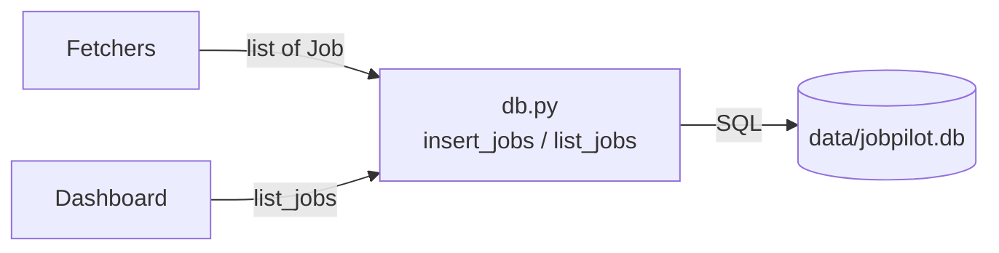

# 01 — Dataclasses, SQLite and the repository idea

## The concept in plain words
- A **dataclass** is a class whose job is to hold data. `@dataclass` writes `__init__`,
  `__eq__` and `__repr__` for you. `frozen=True` makes instances immutable, and `slots=True`
  makes them smaller and blocks typos like `job.titel = ...`.
- **SQLite** is a whole SQL database in a single file. Python ships the `sqlite3` module,
  so there is no server and no install.
- The **repository pattern** keeps SQL in one module (`db.py`). The rest of the app only
  sees `Job` objects, so it never touches SQL.

## Why we used it here
- `Job` is the shared language between fetchers, the pipeline and the UI. Making it immutable
  means no module can quietly change a job another module is using.
- `INSERT OR IGNORE` + `id PRIMARY KEY` makes inserts **idempotent**: fetching the same
  jobs twice doesn't create duplicates.
- Functions take a `conn` argument instead of opening their own connection. That is dependency
  injection without a container: tests pass a temp-file DB (`tmp_path`).
- Datetimes are stored as ISO-8601 text because SQLite has no real datetime type.

## .NET equivalent
| Python | .NET |
|---|---|
| `@dataclass(frozen=True, slots=True) class Job` | `public sealed record Job(string Id, ...)` |
| `field(default_factory=utc_now)` | `public DateTime FetchedAt { get; init; } = DateTime.UtcNow;` |
| `sqlite3` + hand-written SQL | `Microsoft.Data.Sqlite` + Dapper |
| `with conn:` (transaction) | `using var tx = conn.BeginTransaction(); ... tx.Commit();` |
| `db.py` functions | `IJobRepository` / `JobRepository` |
| pytest fixture with `tmp_path` | xUnit fixture + temp SQLite file |

## Self-check
1. Why does calling `insert_jobs` twice with the same jobs not create duplicates?
2. What would break if `Job` were mutable and two parts of the app shared one instance?
3. Why do the db functions receive a connection instead of creating one inside?
