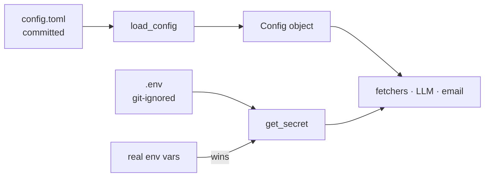

# 02 — Config vs secrets (tomllib + .env)

## The concept in plain words
- **Config** is settings that are safe to share: role keywords, locations, which sources to use.
  It lives in `config.toml` and **is committed**, so changes to it are reviewed like code.
- **Secrets** are anything that grants access: API keys, passwords. They live in `.env` (git-ignored)
  or in real environment variables, and the app reads them at runtime. `.env.example` lists the names
  without values.
- **TOML** is a simple config format (`key = value`, `[sections]`). Python 3.11+ can read it with the
  built-in `tomllib`; nothing extra to install.
- **Fail fast with a clear message**: validate config at startup and raise `ConfigError("[search].locations
  must be a non-empty list")`, instead of crashing later with a confusing `KeyError`.

## Why we used it here
- Your search preferences change often. Editing a TOML file beats editing code.
- `load_config()` returns a **typed, frozen** `Config`, so the rest of the app uses `cfg.search.locations`
  (with autocomplete) instead of digging through `dict["search"]["locations"]`.
- `get_secret()` gives real environment variables priority over `.env`. CI or Task Scheduler can inject
  keys without a file.

## .NET equivalent
| JobPilot | ASP.NET Core |
|---|---|
| `config.toml` | `appsettings.json` |
| `Config` / `SearchConfig` frozen dataclasses | `IOptions<SearchOptions>` POCOs |
| validation in `load_config()` | `ValidateDataAnnotations().ValidateOnStart()` |
| `.env` + `python-dotenv` | User Secrets (`dotnet user-secrets`) |
| env vars override `.env` | env vars override appsettings in the config provider chain |

## Self-check
1. Your Gemini key: config.toml or .env? Why?
2. What does the user see if `[sources].enabled` contains `"linkedin"`, and why is that better than ignoring it?
3. Why do real environment variables override `.env` values?
