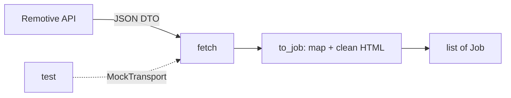

# 03 — HTTP clients, mocking HTTP, mapping DTOs

## The concept in plain words
- An **HTTP client** sends requests and reads responses. `httpx.Client` reuses connections,
  so one client per fetch run is cheaper than one per request. Give it a **timeout**, so a slow
  site can't hang the app forever, and an honest **User-Agent**, so site owners know who's calling.
- A **DTO** (data transfer object) is the shape of someone else's data, here Remotive's JSON.
  We **map** it to our own `Job` at the edge (`to_job()`), so the rest of the app never
  depends on Remotive's field names like `company_name` or `candidate_required_location`.
- **Mocking HTTP** means tests don't touch the network. `httpx.MockTransport(handler)` swaps
  the real network layer for a function that returns a fake response. Tests stay fast and
  deterministic, and they run in CI without internet access or rate-limit worries.

## Why we used it here
- `fetch(client)` *receives* the client (dependency injection again), so tests pass a mock
  client and production passes `make_client()`.
- One malformed job must not break the whole fetch: `to_job` errors are logged and skipped.
- Remotive's terms: link back (we keep their URL), credit the source (`source="remotive"`),
  and make at most ~4 calls a day. So we make one call per run, with no category loops.

## .NET equivalent
| Python | .NET |
|---|---|
| `httpx.Client(timeout=20, headers=...)` | `HttpClient` from `IHttpClientFactory` with `Timeout` + `DefaultRequestHeaders.UserAgent` |
| `with make_client() as client:` | `using var client = ...` |
| `response.raise_for_status()` | `response.EnsureSuccessStatusCode()` |
| `httpx.MockTransport(handler)` | a fake `HttpMessageHandler` passed to `new HttpClient(handler)` |
| `to_job(raw)` | a mapper (manual or AutoMapper) from `RemotiveJobDto` to `Job` |

## Self-check
1. Why does `fetch` take a client as a parameter instead of creating one?
2. What happens to the other jobs if one Remotive item is missing its `title`?
3. Why is mapping to `Job` at the edge better than passing Remotive's dict around the app?
