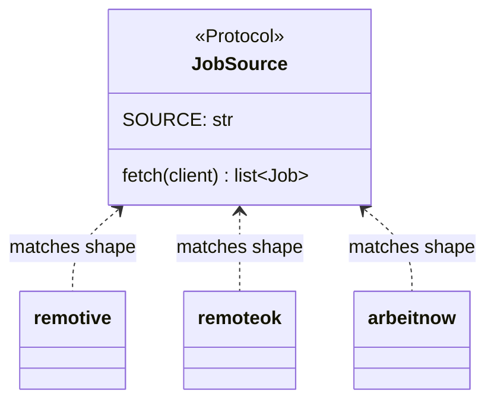

# 04 — typing.Protocol and duck typing

## The concept in plain words
- **Duck typing**: "if it walks like a duck and quacks like a duck, it's a duck." Python doesn't
  care what *type* an object is, only whether it has the attributes you use. If something has
  `SOURCE` and `fetch(client)`, we can treat it as a job source.
- **`typing.Protocol`** writes that "shape" down so tools like editors and type checkers can verify it.
  It's an interface checked **structurally** (by shape), not **nominally** (by name). Nothing has to
  say `implements JobSource`.
- `@runtime_checkable` also makes `isinstance(x, JobSource)` check the shape at runtime. We
  use it in a test to prove every source module follows the contract.

## Why we used it here
- Our sources are plain **modules** (`remotive.py`, `remoteok.py`, `arbeitnow.py`) with a
  `SOURCE` constant and a `fetch()` function. No classes, no base class, no boilerplate.
  A module already satisfies the Protocol.
- In #6 the pipeline will loop over "anything that is a `JobSource`", so adding a new
  source means adding one module.
- Real-world APIs are messy. That's why the shared helpers fix it in **one** place:
  `fix_mojibake()` repairs double-encoded text (`—` → `—`) and `html_to_text()` now
  also handles escaped HTML (`
`).

## .NET equivalent
| Python | C# |
|---|---|
| `class JobSource(Protocol)` | `interface IJobSource` |
| structural: shape matches → it's a JobSource | nominal: must declare `: IJobSource` |
| module with `SOURCE` + `fetch()` | `class RemoteOkSource : IJobSource` |
| `isinstance(m, JobSource)` with `@runtime_checkable` | `obj is IJobSource` |
| Closest C# analogue to duck typing | `dynamic`, or Go-style interfaces (C# doesn't have them) |

## Self-check
1. What's the difference between structural and nominal typing?
2. Why don't our source modules need to import `JobSource` at all?
3. Why put `fix_mojibake` / escaped-HTML handling in `http.py` instead of in each source?
