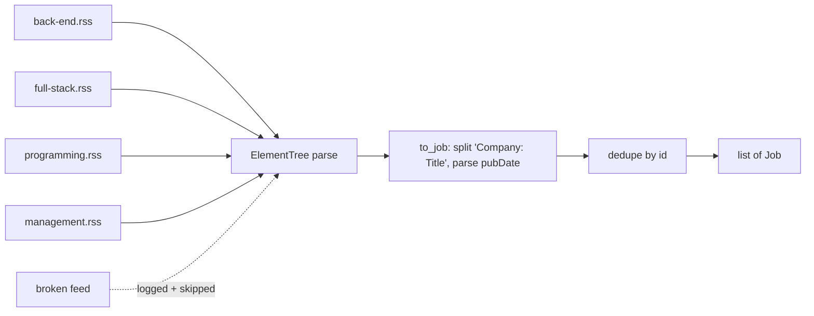

# 05 — RSS, XML parsing and fixture files

## The concept in plain words
- **RSS** is an old, simple XML format for "a list of recent items". Each `<item>` has a `<title>`,
  `<link>`, `<pubDate>`, `<description>` and so on. Many sites that have no JSON API still offer RSS.
- **XML parsing** with Python's built-in `xml.etree.ElementTree`:
  `ET.fromstring(bytes)` builds a tree, `.iter("item")` walks every item, and `.findtext("title")`
  reads a child's text. Tags with a prefix like `<media:content>` belong to a **namespace**.
  We ignore them because we only read plain tags.
- RSS dates use the email format (`Thu, 05 Nov 2026 17:12:27 +0000`).
  `email.utils.parsedate_to_datetime` turns that into a timezone-aware `datetime`.
- A **fixture file** is a small, saved copy of real input (`tests/fixtures/wwr.xml`). Tests run
  against it offline, and deliberately bad items in it prove the edge cases are handled.

## Why we used it here
- WWR has no JSON API, but its per-category RSS feeds are free, public and stable.
- We read 4 feeds (back-end, full-stack, programming, management). A job can be in several feeds, so
  we **dedupe by id within the fetch** (`dict.setdefault`).
- **Partial failure**: if one feed is down or returns broken XML, we log it and still return
  the others. One bad source shouldn't zero out the run.
- Stdlib parser, so no new dependency. Modern Python's expat parser already guards against the
  classic "billion laughs" XML attack, so `defusedxml` isn't needed for this use.

## .NET equivalent
| Python | .NET |
|---|---|
| `xml.etree.ElementTree` | `System.Xml.Linq` (`XDocument`, `XElement`) |
| `root.iter("item")` | `doc.Descendants("item")` |
| `item.findtext("title")` | `(string?)item.Element("title")` |
| `parsedate_to_datetime(...)` | `DateTimeOffset.Parse(..., CultureInfo.InvariantCulture)` |
| (no built-in feed reader used) | `System.ServiceModel.Syndication.SyndicationFeed` |
| fixture file in `tests/fixtures/` | embedded resource / `TestData` folder copied to output |

## Self-check
1. Why do we split the title on `": "`, and what happens if there's no company prefix?
2. Why does one failing feed not make `fetch` raise?
3. What's the advantage of a fixture file over building the XML string inside the test?
