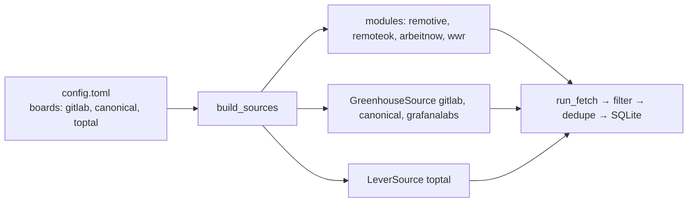

# 07 — Public ATS APIs and config-driven sources

## The concept in plain words
- An **ATS** (Applicant Tracking System) is the software companies use to post jobs and manage
  applicants. Greenhouse and Lever are two of the most common ones. They host the careers page
  *and* expose it as a **free public JSON API**, with no key needed, because companies want their jobs found.
  - Greenhouse: `boards-api.greenhouse.io/v1/boards/<board>/jobs?content=true`
  - Lever: `api.lever.co/v0/postings/<company>?mode=json`
  - You find the `<board>` / `<company>` name in the careers URL (`jobs.lever.co/toptal`).
- **Config-driven sources**: the *code* knows how to talk to Greenhouse. The *config* says which
  companies to watch. Adding a company is a one-line `config.toml` change, with no code, review or deploy.
- **Module vs class**: Remotive or RemoteOK need no settings, so a module with `fetch()` is enough.
  A board source needs a list of companies, so it's a small class holding that list. Both satisfy
  the same `JobSource` Protocol, because the Protocol only checks shape.

## Why we used it here
- Company boards give **first-hand** postings (no aggregator delay) from companies you choose.
- `build_sources(config)` replaces the fixed registry: it builds the fixed modules plus the board
  classes from `[boards]`. Tests pass their own fake sources, so no network is needed.
- One company's board failing (renamed, 404, error payload) is logged and skipped.
- Live run: Greenhouse 715 jobs from 3 companies → 92 matched → 87 new.

## .NET equivalent
| Python | .NET |
|---|---|
| `[boards] greenhouse = ["gitlab"]` | `appsettings.json` section bound to `IOptions<BoardsOptions>` |
| `GreenhouseSource(boards)` class | `class GreenhouseSource(IOptions<BoardsOptions> o) : IJobSource` |
| `build_sources(config)` | DI registration: `services.AddSingleton<IJobSource, GreenhouseSource>()` etc. |
| module-as-source vs class-as-source | static class vs instance; both "implement" the interface by shape here |

## Self-check
1. Why are Greenhouse/Lever sources classes, while Remotive is just a module?
2. How would you start watching a new company that uses Lever? Which file changes?
3. Why does `run_fetch` accept an optional `sources` argument instead of always calling `build_sources`?
