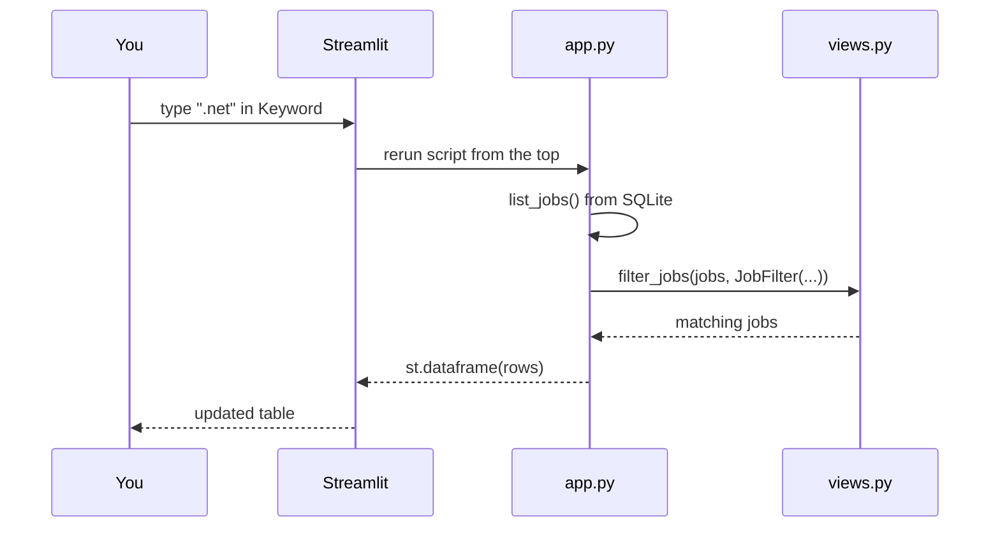

# 08 — Streamlit's rerun model and separating UI from logic

## The concept in plain words
- **Streamlit re-runs your whole script, top to bottom, on every interaction.** Typing in the
  keyword box doesn't call an event handler. Streamlit runs `app.py` again, and this time
  `st.text_input(...)` *returns* the new text. A widget is a function call that returns the current value.
- That makes UI code read like a plain script: load data → read widgets → filter → draw.
  The price: anything slow at the top (DB reads, API calls) runs again on every click. Later we can
  use `@st.cache_data` to keep a result between reruns. With ~100 jobs, SQLite is fast enough without it.
- **Separate UI from logic**: `app.py` only wires widgets to functions. The real logic
  (`filter_jobs`, `to_rows`) lives in `jobpilot/views.py` with no Streamlit import, so it's
  unit-tested like any function. `AppTest` then smoke-tests the wiring headless.

## Why we used it here
- One Python file gives you a working dashboard with no HTML, JS or build step.
- `JOBPILOT_CONFIG` lets the tests point the app at a temp DB, the same injection idea as before.
- `.streamlit/config.toml` turns off Streamlit's default anonymous usage statistics (privacy).
- The app only *reads* and *links*. "Open" takes you to the job site; you apply yourself.

## .NET equivalent
| Streamlit | Blazor Server |
|---|---|
| whole script re-runs on each interaction | component re-renders; only event handlers run |
| `kw = st.text_input("Keyword")` | `<input @bind="Keyword" />` + `@code { string Keyword; }` |
| `st.dataframe(rows)` | `<QuickGrid Items="rows">` |
| `@st.cache_data` | `IMemoryCache` / a scoped service holding state |
| `views.py` (pure logic) | a plain C# service class, unit-tested without bUnit |
| `AppTest.from_file("app.py")` | bUnit component tests |

## Self-check
1. In Streamlit, what happens to code at the top of `app.py` when you change a filter?
2. Why does `views.py` not import Streamlit?
3. How would `@st.cache_data` change behaviour, and when would it start to matter?
