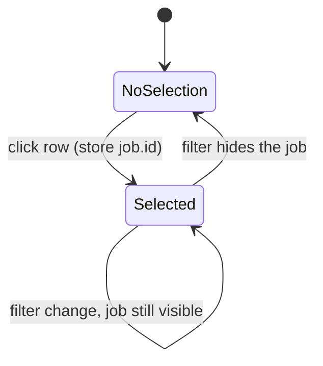

# 09 — st.session_state and UI state

## The concept in plain words
- Streamlit reruns `app.py` from the top on every click, so **normal variables are forgotten**
  between reruns. `st.session_state` is a dictionary that **survives reruns** for one browser
  tab. Anything the UI must remember (here: which job you selected) goes in it.
- A **selectable table**: `st.dataframe(..., on_select="rerun", selection_mode="single-row")`
  triggers a rerun when you click a row and returns `event.selection.rows`, e.g. `[3]`.
- **Store identity, not position.** Row 3 means a different job once you change a filter.
  We store the job's **id** in session state, so the choice stays correct while the list changes.
- **Widget keys reset widget state.** The table's `key` includes the current filters. New filters
  produce a new key, so Streamlit treats it as a new table with no selection, and a stale row index
  can't point at the wrong job.
- The decision itself (`resolve_selection`) is a pure function: a fresh click wins,
  otherwise keep the previous id while it's still visible, otherwise nothing. It's easy to unit-test.

## Why we used it here
- Click a row and the right-hand panel shows the full description and an **Open job posting** button.
  The button only opens the site; JobPilot never applies for you.
- Descriptions are scraped text, so `md_escape` stops "# Benefits" or `*` from being rendered as
  Markdown headings or italics.

## .NET equivalent
| Streamlit | Blazor Server |
|---|---|
| `st.session_state["selected_job_id"]` | a field in the component (`private string? selectedJobId;`), which lives for the circuit |
| `on_select="rerun"` + `event.selection.rows` | `<QuickGrid>` row click → `@onclick="() => Select(job)"` |
| widget `key` changes → fresh widget | `@key` directive forcing a component re-create |
| store id, not index | same advice: bind to `job.Id`, not the loop index |

## Self-check
1. Why would storing the row number (instead of the job id) show the wrong job after filtering?
2. What does including the filters in the table's `key` achieve?
3. Which part of this feature is unit-tested without Streamlit, and why is that valuable?
