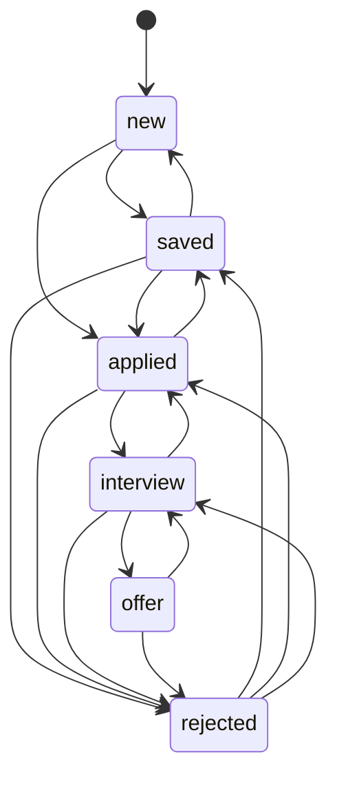

# 10 — Simple state machines and schema migrations

## The concept in plain words
- A **state machine** says *which states exist* and *which moves between them are allowed*.
  Our states: new → saved → applied → interview → offer, plus rejected. The rules live in one
  dictionary (`ALLOWED`), and `change_status()` refuses anything else. Example: you can't jump from
  new to offer, but you can step back one stage to fix a mis-click.
- The UI only offers moves the rules allow (`next_statuses`), so you rarely even see an error.
- A **schema migration** is a numbered, one-time change to the database structure. SQLite keeps a
  free integer, `PRAGMA user_version`. `init_db()` runs every migration newer than that number,
  each in its own transaction, then bumps the number. Old databases upgrade themselves on startup,
  and your 114 jobs were kept.
- **Golden rule:** never edit a migration that has already run somewhere. Add a new one.

## Why we used it here
- A separate `applications` table keeps "what the board said" (`jobs`) apart from "what I did".
  A job with no row is implicitly *new*, so there are no rows for 1,000 untouched jobs.
- The DB also guards itself: `CHECK (status IN (...))` rejects an unknown status even if a bug slips past Python.
- `ON CONFLICT ... DO UPDATE` (an **upsert**) means "insert, or update if it exists" in one statement.
- After Save we `st.rerun()` so the table and tracker show the new status, and a `flash` message in
  `session_state` survives that rerun.

## .NET equivalent
| JobPilot | .NET |
|---|---|
| `Status(StrEnum)` + `ALLOWED` dict | `enum Status` + `Dictionary<Status, HashSet<Status>>` (or the Stateless library) |
| `InvalidTransition` | `InvalidOperationException` / a domain exception |
| `MIGRATIONS` tuple + `PRAGMA user_version` | EF Core migrations + `__EFMigrationsHistory` table |
| `init_db()` on startup | `db.Database.Migrate()` in `Program.cs` |
| `INSERT ... ON CONFLICT DO UPDATE` | `MERGE` in SQL Server / EF `Update` after a lookup |

## Self-check
1. Why is the "allowed moves" table better than checking `if status == ...` in several places?
2. A teammate edits migration #2 after you've run it. What goes wrong on your machine?
3. Why do we store no row for jobs you haven't touched?
