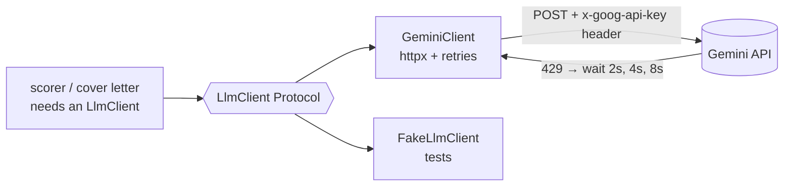

# 11 — Calling an LLM: provider abstraction, API keys, retries

## The concept in plain words
- **An LLM API is just HTTP + JSON.** You POST `{"contents": [{"parts": [{"text": "your prompt"}]}]}`
  and read `candidates[0].content.parts[*].text` from the reply. There's no magic, and an SDK only wraps this.
  `systemInstruction` sets the model's role, and `responseMimeType: application/json` asks for JSON.
- **Provider abstraction**: the app depends on a tiny `LlmClient` Protocol (`generate(prompt) -> str`),
  never on Gemini directly. Switching to Groq or a local Ollama later means writing one new class.
- **Dependency injection**: code that needs an LLM *receives* a client. Production gets
  `GeminiClient`; tests get `FakeLlmClient` (canned replies, records prompts). Tests then use no network,
  no key and no free-tier quota, and they're deterministic, which real LLMs are not.
- **API key hygiene**: the key comes from `.env` / environment (`get_secret`), travels in a **header**
  (`x-goog-api-key`), never in the URL (URLs end up in logs), and is never printed, even in errors.
- **Retries with exponential backoff**: free tiers return **429 Too Many Requests** often. We wait
  2s, 4s, 8s... (or the server's `Retry-After`) and retry, but only for 429, 5xx and network errors.
  A 400 "invalid key" will never succeed, so retrying it just wastes time.

## Why we used it here
- Plain `httpx` (your choice): no new dependency, and you can see exactly what the model receives.
- The `sleep` function is injected, so the retry test runs instantly and can check the exact waits.
- `python -m jobpilot llm-check` proves your key and model work without you sharing the key.

## .NET equivalent
| JobPilot | .NET |
|---|---|
| `LlmClient` Protocol | `IChatClient` (Microsoft.Extensions.AI) / your own `ILlmClient` |
| `GeminiClient(api_key, model, http)` | typed `HttpClient` registered with `AddHttpClient<GeminiClient>()` |
| retry 429/5xx with backoff | Polly / `AddStandardResilienceHandler()` |
| `FakeLlmClient` | a hand-written fake or a Moq mock of `ILlmClient` |
| `get_secret("GEMINI_API_KEY")` | User Secrets / `IConfiguration["Gemini:ApiKey"]` |

## Self-check
1. Why is the key sent in a header rather than as `?key=...` in the URL?
2. Why do we retry a 429 but not a 400?
3. What do tests gain from `FakeLlmClient` besides "no network"?
