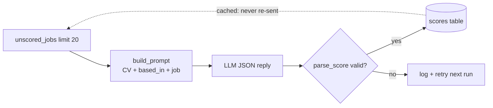

# 12 — Prompt design, structured output, caching, rate limits

## The concept in plain words
- **Prompt design**: the model only knows what you send. Our prompt has a **system** part (role,
  scoring rubric with bands, exact output format) and a **user** part (your CV, where you're based,
  target roles, the job). A clear rubric ("0-49 = poor fit *or* you can't take it") makes
  scores consistent between jobs. Telling it you're **based in Dhaka** lets it mark down
  "Remote, Poland" or "US only" roles, which keyword filters can't judge.
- **Structured output**: we ask for JSON (`responseMimeType: application/json`) *and* still
  **validate** it: it must be an object, `score` a number from 0 to 100 (not `"80"`, not `true`), and
  `reason` a non-empty string. LLMs sometimes add ```` ``` ```` fences or drift, so treat the output
  like any untrusted user input.
- **Caching**: a scored job is stored in `scores` and never sent again. That saves quota, money
  and time, and keeps the dashboard stable. We also store `cv_hash` and `model`, so later we can see
  which scores came from an older CV.
- **Rate limits**: free tiers allow few requests per minute. We pace ourselves
  (`60 / requests_per_minute` seconds between calls) *and* still back off on 429 (#11).
  `--limit 20` protects the daily quota.

## Why we used it here
- A bad reply never corrupts the DB: it's logged, counted as failed, and retried next run.
- Descriptions are cut at 6,000 characters: the useful part is usually at the top, and tokens are quota.
- Tests use `FakeLlmClient`, so we test *our* logic (prompt, validation, caching, pacing) deterministically.

## .NET equivalent
| JobPilot | .NET |
|---|---|
| system + user prompt strings | `ChatMessage(ChatRole.System, ...)` + `ChatMessage(ChatRole.User, ...)` |
| `parse_score` validation | `JsonSerializer.Deserialize<ScoreDto>` + FluentValidation / DataAnnotations |
| `scores` table as cache | `IDistributedCache` / a persisted results table |
| pacing with `sleep(60/rpm)` | `System.Threading.RateLimiting` (`FixedWindowRateLimiter`) |
| `--limit 20` | a batch size in a Hangfire / hosted-service job |



## Self-check
1. Why validate the JSON if we already asked the model for JSON?
2. What would happen to your free quota without the cache?
3. Why does the prompt include where you're based, when the fetch filter already checks location?
