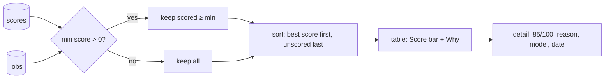

# 13 — Putting AI output into the UX

## The concept in plain words
- An AI score is a **suggestion, not a fact**. Good UX shows it clearly *and* signals its limits:
  the score sits next to its **reason** ("Why"), plus **who** made it (model) and **when**, and
  the text says "AI estimate... use your judgement".
- **Missing is not zero.** A job that hasn't been scored yet is unknown, not bad. So unscored
  jobs show an empty Score cell and a hint to run `score`, and they sort *after* scored ones instead
  of pretending to be 0. A min-score filter above 0 hides them, because they haven't earned a place
  above the quality bar yet.
- **Rank, don't hide.** Sorting best-first while still showing everything (min score 0) keeps
  you in control. The slider is your choice, not the AI's.
- **Make it scannable.** The Score column is a 0–100 progress bar, and the caption says how many jobs
  are scored ("40 of 114"), so you can tell when a `score` run is due.

## Why we used it here
- This is where the M3 work pays off: open the dashboard and the best matches for a Dhaka-based
  .NET/AI engineer are at the top, each with a one-line reason.
- All the rules (`filter_jobs` with `min_score`, `sort_by_score`, the Score/Why columns) are pure
  functions in `views.py`, tested without Streamlit or an LLM. `AppTest` checks the wiring with a
  pre-saved score.

## .NET equivalent
| JobPilot | .NET / Blazor |
|---|---|
| `sort_by_score` (unscored last) | LINQ `OrderByDescending(j => j.Score ?? int.MinValue)` |
| `min_score` filter | `Where(j => minScore == 0 \|\| j.Score >= minScore)` |
| `ProgressColumn` in `st.dataframe` | a `<QuickGrid>` template column with a progress bar |
| `st.metric("Match", "85/100")` | a small Blazor card component |
| `Score | None` | `int?` (nullable) |

## Self-check
1. Why do unscored jobs sort last instead of counting as score 0?
2. Why show the model name and date next to a score?
3. What should happen to unscored jobs when you set the slider to 60, and why?
