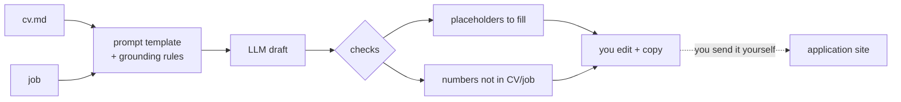

# 14 — Prompt templates, grounding and hallucination control

## The concept in plain words
- A **prompt template** is a fixed text with slots (`{cv}`, `{title}`, `{description}`) filled in
  per job. The instructions stay identical every time, so results are consistent and you can
  review and improve one place.
- **Grounding** means telling the model what its *only* source of truth is: "use ONLY facts stated
  in the CV". LLMs are trained to sound fluent, so without this they happily write
  "my 12 years leading Kafka teams" because it *fits*, not because it's *true*.
- **Hallucination control** is layered, because instructions alone aren't a guarantee:
  1. **Prevent**: grounding rules, plus "if unknown, write a `[placeholder]`" so the model has an
     honest way out instead of inventing.
  2. **Detect**: cheap code checks after generation. `placeholders()` lists the gaps you must fill.
     `unsupported_numbers()` flags any number that appears in neither your CV nor the job.
     Numbers are the easiest invented claims to catch mechanically.
  3. **Human in the loop**: the draft is editable, warnings are visible, and JobPilot never sends
     anything. You are the final check.

## Why we used it here
- A cover letter with a made-up claim can cost you the job, or worse, so this is where grounding
  matters most in JobPilot.
- Drafts are saved per job (`cover_letters` table, migration v4), with the model and CV version
  recorded. Your edits are saved too, and "Regenerate" is always an explicit click.
- `st.code` gives a one-click copy box. The text-area key includes the generation time, so a
  regenerated draft isn't hidden behind the old widget state.

## .NET equivalent
| JobPilot | .NET |
|---|---|
| `TEMPLATE.format(cv=..., title=...)` | Semantic Kernel prompt templates / Handlebars / `string.Format` |
| grounding rules in the system prompt | the same: system message in `IChatClient` |
| `unsupported_numbers()` post-check | a validation step / FluentValidation rule on the output |
| editable draft, never auto-sent | "draft" state in a workflow; a human approves before send |

## Self-check
1. Why does asking for `[placeholders]` reduce hallucinations?
2. The draft says "10 years" and your CV says "10 years". Is it flagged? What about "12 years"?
3. Name two hallucinations that `unsupported_numbers()` would *not* catch. How do you catch those?
