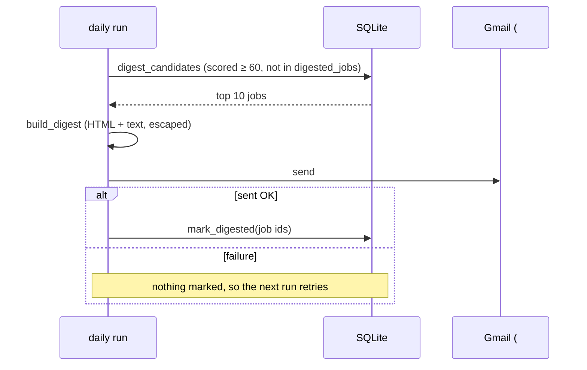

# 15 — Templating and idempotent batch jobs

## The concept in plain words
- **Templating** = fixed layout + slots. Python's built-in `string.Template` fills `$title`,
  `$score` and so on. We render two versions of the same email: **HTML** (pretty) and **plain text**
  (for clients that block HTML, and for previews). Sending both is standard email practice.
- **Escape untrusted text.** Job titles come from strangers on the internet. If one says
  `<script>...` or `A&B`, putting it raw into HTML can break the layout or inject markup.
  `html.escape()` turns `<` into `&lt;`, so it shows as text. The plain-text part isn't HTML,
  so it isn't escaped.
- **Idempotent batch job**: a job that runs on a schedule must be safe to re-run. We log each
  emailed job in `digested_jobs`. The next run selects only jobs not in that log, so:
  - a job is never emailed twice, even if it was scored late;
  - if sending fails, nothing is marked, so the next run retries the same jobs;
  - marking twice is harmless (`INSERT OR IGNORE`).
- **No news is no email.** `build_digest` returns `None` for an empty batch, so you never get
  an empty "0 new matches" mail.

## Why we used it here
- The order of operations is the key rule: **build → send → mark**. #16 calls `mark_digested`
  only after Gmail accepts the message. If you marked first, a failed send would silently lose jobs.
- `[digest] top_n` and `min_score` in `config.toml` keep the mail short and relevant.

## .NET equivalent
| JobPilot | .NET |
|---|---|
| `string.Template` HTML | Razor templates (RazorLight) / Scriban / Fluid |
| `html.escape()` | `HtmlEncoder.Default.Encode()` (Razor does it automatically with `@`) |
| HTML + text parts | `MimeKit` `BodyBuilder { HtmlBody, TextBody }` |
| `digested_jobs` log | an outbox / "processed messages" table for idempotency |
| run on a schedule | Hangfire recurring job / `BackgroundService` |

## Self-check
1. Why must jobs be marked *after* sending, not before?
2. What could go wrong if a job title containing `<b>` were inserted into the HTML unescaped?
3. Why do we send a plain-text version as well as HTML?
