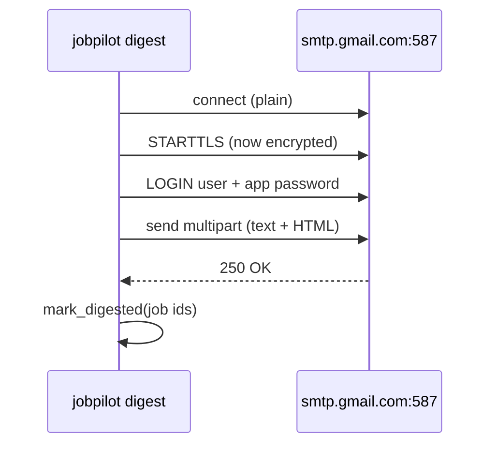

# 16 — SMTP, app passwords and the dry-run pattern

## The concept in plain words
- **SMTP** is the protocol mail servers use to accept mail. Sending from Python means: connect to
  `smtp.gmail.com:587`, say **STARTTLS** to switch the connection to encryption, **log in**, then
  hand over the message. The order matters: never log in before TLS, or your password crosses the
  network in plain text.
- **App passwords**: Gmail won't accept your normal password from scripts. With 2-step verification
  on, you create a 16-character **app password** that only works for mail, and you can revoke it
  any time without changing your real password. That's least privilege in practice.
- **MIME multipart/alternative**: one email carrying a plain-text and an HTML version.
  `EmailMessage.set_content(text)` + `add_alternative(html, subtype="html")` builds it, and the mail
  app shows the best one it supports.
- **Dry run**: `--dry-run` does everything *except* the side effects. It builds and prints the email,
  but sends nothing and marks nothing. Use it to check content and config safely, and in CI or
  demos where you must not send real mail.

## Why we used it here
- The order is **build → send → mark** (#15). The test proves it: if login fails, nothing is marked,
  and the next run retries the same jobs.
- Errors never contain the password. A login failure is translated into a helpful hint
  ("use an app password, not your normal password").
- `smtp_factory` is injected (default looked up at call time), so tests use a `FakeSMTP` that records
  the conversation: connect → starttls → login → send.
- A **subprocess test** runs the real `python -m jobpilot ...`. It catches bugs that importing
  the module in tests can't, like the `if __name__ == "__main__"` guard sitting above a function
  it calls. That bug happened here once and is now covered.

## .NET equivalent
| JobPilot | .NET |
|---|---|
| `smtplib.SMTP` + `starttls()` + `login()` | MailKit `SmtpClient.Connect(host, 587, SecureSocketOptions.StartTls)` + `Authenticate` |
| `EmailMessage` text + HTML | MimeKit `BodyBuilder { TextBody, HtmlBody }` |
| app password in `.env` | User Secrets / Key Vault secret |
| `--dry-run` flag | a `--what-if` switch / `IEmailSender` swapped for a logging fake |
| `FakeSMTP` in tests | a fake `IEmailSender` / smtp4dev |

## Self-check
1. Why must `starttls()` come before `login()`?
2. Why is an app password safer than putting your real Gmail password in `.env`?
3. What exactly does `--dry-run` skip, and why should it also skip marking jobs as sent?
