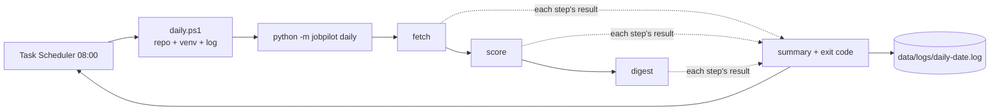

# 17 — Scheduling: Task Scheduler / cron vs hosted services

## The concept in plain words
- A **scheduler** starts your program at set times. On Windows that's **Task Scheduler**; on
  Linux/macOS it's **cron** (`0 8 * * * /path/daily.sh`). The program runs, does its work, and exits.
  Nothing stays running in between.
- The alternative is a **hosted service**: a long-running process with a timer inside
  (ASP.NET `BackgroundService`, Hangfire recurring jobs). That's useful when you already have a
  server running, but it's overkill for a personal tool on a laptop.
- **Design for the scheduler:**
  - **One entry point** (`python -m jobpilot daily`) so the schedule is one line.
  - **Keep going on failure**: no API key yet shouldn't stop fetching. Each step runs and is reported.
  - **Exit code** = the truth: 0 only if all steps succeeded. Task Scheduler shows it as "Last Run Result".
  - **Logs to a file** (`data/logs/daily-<date>.log`): there's no console to look at when it runs at 08:00.
  - **Idempotent steps** (#6, #12, #15): a double run or a retry after a crash does no harm.
- **Thin script, logic in Python**: `daily.ps1` only finds the repo and venv, runs the command and
  logs. The step logic lives in Python where it's unit-tested and works the same on any OS.

## Why we used it here
- Free, built into Windows, no server, no extra framework: it fits the "smallest thing that works" rule.
- `-StartWhenAvailable`: if the laptop was asleep at 08:00, the task runs when it wakes up.
- It runs only while you're logged in, so no stored password and no admin rights are needed.

## .NET equivalent
| JobPilot | .NET |
|---|---|
| Task Scheduler + `daily.ps1` | Task Scheduler running a console app, or a Windows Service |
| `python -m jobpilot daily` | `dotnet MyApp.dll daily` |
| cron on Linux | cron / systemd timer / Kubernetes CronJob |
| hosted alternative | `BackgroundService` with `PeriodicTimer`, Hangfire `RecurringJob.AddOrUpdate` |
| exit code to scheduler | `return 1;` from `Main` → Last Run Result |

## Self-check
1. Why keep the step logic in Python instead of in the PowerShell script?
2. Fetch succeeds, score fails (no key). Does the digest run? What exit code does the task get?
3. When would a hosted service (Hangfire / `BackgroundService`) be the better choice?
