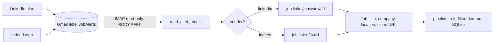

# 18 — IMAP, email parsing and ToS-safe ingestion

## The concept in plain words
- **ToS-safe ingestion**: LinkedIn and Indeed forbid scraping, but they *email you* job alerts you
  subscribed to. Reading your own mailbox is fine, so we get their jobs without touching their sites.
- **IMAP** is the protocol for *reading* a mailbox (SMTP from #16 is for *sending*). Steps: connect over
  TLS to `imap.gmail.com`, log in (the same app password), `SELECT` one folder or label **read-only**,
  `SEARCH SINCE <date>`, then `FETCH` each message with **`BODY.PEEK[]`**. Plain `BODY[]` would mark it
  as read; PEEK leaves your inbox exactly as it was.
- **Email parsing**: an email is MIME, a tree of parts (text, HTML, images). `email.message_from_bytes`
  plus `msg.get_body(preferencelist=("html",))` gives the HTML part.
- **Layout-agnostic parsing**: alert HTML is messy and changes often, but *job links* are stable
  (`linkedin.com/.../jobs/view/<id>`, `indeed...?jk=<id>`). We flatten the HTML into a sequence of
  links and texts. Each job link is a job: its text is the title, and the next text lines are company
  and location. Logo links (no text) and "See all jobs" links are ignored.
- **Privacy by design**: we rebuild a canonical URL from the job id, dropping tracking parameters
  that identify you. Real emails stay in git-ignored `samples/`, and fixtures are synthetic.

## Why we used it here
- `AlertEmailSource` plugs into the same `JobSource` pipeline, so dedupe, scoring, the dashboard and the
  digest all just work. `TRUSTED_LOCATION` skips the keyword location check, because your alert
  settings already chose the location.
- **Honest caveat**: the fixtures are *synthetic* approximations of real alerts. Verify on your real mail
  and adjust if company or location come out wrong.

## .NET equivalent
| JobPilot | .NET |
|---|---|
| `imaplib.IMAP4_SSL` + `select(readonly=True)` | MailKit `ImapClient` + `folder.Open(FolderAccess.ReadOnly)` |
| `FETCH (BODY.PEEK[])` | MailKit `GetMessage` on a read-only folder (no `\Seen` flag set) |
| `email.message_from_bytes` | MimeKit `MimeMessage.Load(stream)` |
| `html.parser.HTMLParser` tokens | AngleSharp / HtmlAgilityPack |
| synthetic `.eml` fixtures | test `.eml` files loaded from a `TestData` folder |

## Self-check
1. What's the difference between `BODY[]` and `BODY.PEEK[]`, and why does it matter here?
2. Why parse by job links instead of the exact HTML layout?
3. Why rebuild the job URL instead of storing the link from the email?
