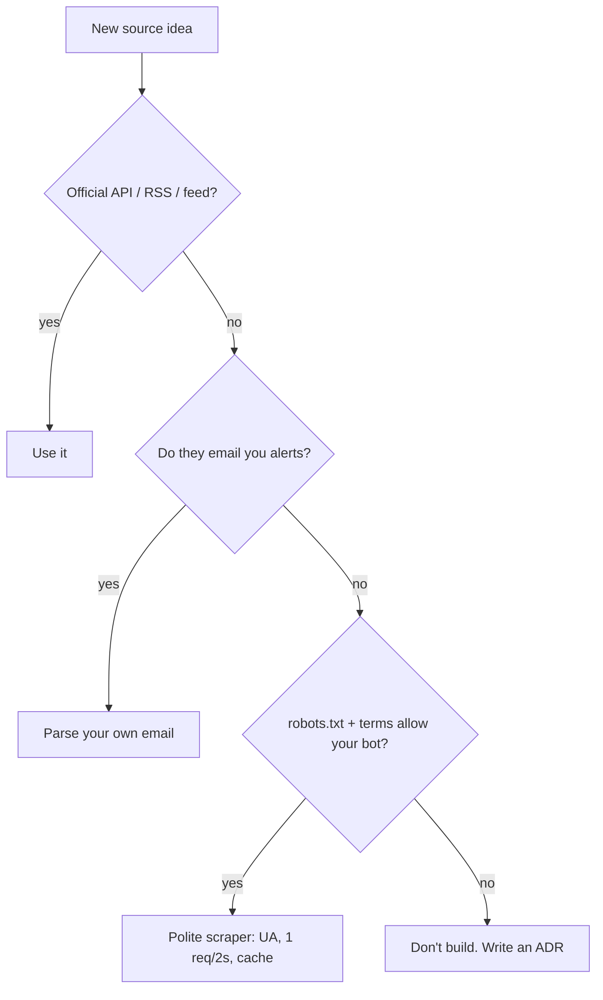

# 19 — Scraping ethics: robots.txt, and knowing when not to build

## The concept in plain words
- **robots.txt** is a site's public note to bots: which paths each crawler (`User-agent`) may visit.
  It isn't a lock, but ignoring it is ignoring the owner's explicit wishes. It can also be a step
  toward breaking their terms of service, getting your IP blocked, or worse.
- **How to read it:** find the groups for your user-agent (or `*` if you're not named). Per
  **RFC 9309**, several groups for the same agent are **merged**, and the most specific (longest) matching
  rule wins between `Allow` and `Disallow`.
- **Bdjobs' file** allows Google, Bing, LinkedIn and Facebook, but its *last* `User-agent: *` group says
  `Disallow: /`, so any other bot is shut out.
- **Tools can be wrong.** Python's `urllib.robotparser` uses only the *first* `*` group and said
  "allowed". Read the file yourself when it matters.
- **Polite scraping, when it *is* allowed:** identify yourself (honest User-Agent), rate-limit
  (e.g. 1 request every 2s), cache, fetch only what you need, respect `Retry-After`, and check the terms.
- **Knowing when not to build** is an engineering skill. The issue's first acceptance criterion
  was "checks robots.txt". The check said no, so the right deliverable is a recorded decision
  (ADR 0003), not code.

## Why it matters here
- JobPilot's sources so far are all *invited*: public APIs/RSS (Remotive, RemoteOK, Arbeitnow, WWR),
  public ATS APIs (Greenhouse, Lever), and emails sent to you (LinkedIn/Indeed alerts).
- If Bdjobs is wanted later: their **job-alert emails** fit the #18 pipeline with one more parser.

## .NET equivalent
| Concept | .NET world |
|---|---|
| robots.txt check | `RobotsTxt` NuGet parsers (check they merge groups!) or reading it yourself |
| polite rate limit | `System.Threading.RateLimiting` / Polly rate limiter |
| honest User-Agent | `HttpClient.DefaultRequestHeaders.UserAgent` |
| "won't do" decision | an ADR in the repo, plus closing the work item with a reason |

## Self-check
1. Two `User-agent: *` groups: one disallows `/images/`, one disallows `/`. Can JobPilot fetch `/jobs`? Why?
2. Why wasn't `urllib.robotparser`'s answer enough here?
3. Name three habits that make a scraper "polite" when it *is* allowed.
