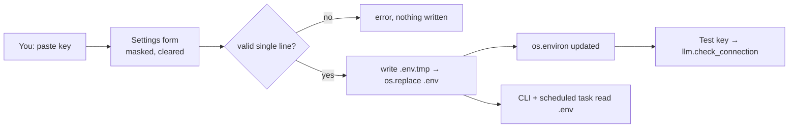

# 20 — Handling secrets in a UI, file-backed config, localhost binding

## The concept in plain words
- **File-backed config**: the UI doesn't invent a new store. It *writes* the same `.env` file that the
  CLI and the scheduler already *read*, so there's one source of truth and no sync problems.
- **Editing a config file safely:**
  - change only your keys and keep comments and other lines (users hand-edit these files too);
  - **validate input**: a value with a newline could inject `EVIL=1` as a second line, so reject it;
  - **atomic write**: write `.env.tmp`, then `os.replace()` it over `.env`. A crash mid-write never
    leaves a half-written file.
- **Secrets in UIs:**
  - masked input (`type="password"`), cleared after saving;
  - **never echo the secret back**, just "set (ends with abcd)", enough to recognise which key it is;
  - errors never include the secret.
- **Process environment vs file**: `load_dotenv()` only fills variables that are *missing*. After saving,
  the running app still has the old value unless you update `os.environ` too, so `save_secrets` does both.
- **Localhost binding**: a server listening on `0.0.0.0` accepts connections from your whole Wi-Fi.
  `server.address = "localhost"` means only this computer can open the page, and with it the Settings tab.
- **First-run UX**: the empty-database early `st.stop()` used to hide every tab, including the
  Settings tab a new user needs first. Now the Jobs tab shows the hint and the other tabs still render.

## .NET equivalent
| JobPilot | .NET |
|---|---|
| `.env` written by the UI | writing `appsettings.Local.json` / User Secrets from an admin page |
| atomic `os.replace` | `File.Replace` / write temp + `File.Move(overwrite: true)` |
| `os.environ.update` after save | `IConfigurationRoot.Reload()` / `IOptionsMonitor` picking up changes |
| `type="password"` + no echo | `<InputText type="password">`, never bind the stored value back |
| `server.address = "localhost"` | Kestrel `ListenLocalhost(8501)` instead of `ListenAnyIP` |

## Self-check
1. Why reject a value containing a newline?
2. What would happen after saving a new key if we didn't update `os.environ`?
3. Why does binding to `localhost` matter more now than it did before this feature?
