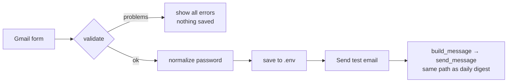

# 21 — Form validation and reusing service code from the UI

## The concept in plain words
- **Validate before you save.** A form is untrusted input, even when you're the only user (typos
  happen). `validate_gmail_settings()` returns a **list of readable problems**, so the UI can
  show all of them at once, and nothing is written while any problem remains.
- **Validate what you can check cheaply, test what you can't.** Format checks (an email shape, an
  app password of 16 letters) catch the common mistakes instantly, like pasting your *normal* Gmail
  password. Whether Google accepts the login can only be proven by a real call, which is what the
  **Send test email** button does.
- **Normalize input**: Google displays app passwords as `abcd efgh ijkl mnop`. We accept that and
  store `abcdefghijklmnop`, so the user never has to guess the format.
- **Blank means "keep"**: a masked field can't show the saved password, so leaving it empty keeps the
  current one. Otherwise every unrelated edit would force you to re-enter a secret.
- **Reuse service code, don't copy it**: the test email goes through `build_message` → `send_message`,
  the **same path as the real digest**. If the test works, the daily email will too. The validation is
  a pure function, so it's unit-tested without Streamlit.
- **Bug found**: after a restart the Settings tab showed "not set", because `.env` was only loaded
  lazily by `get_secret`. Now it's loaded when the tab is drawn, and a restart test covers it.

## .NET equivalent
| JobPilot | .NET |
|---|---|
| `validate_gmail_settings()` → list of problems | FluentValidation `ValidationResult.Errors` / `IValidatableObject` |
| show all errors, save nothing | `ModelState.IsValid` check before saving |
| `normalize_app_password` | a value converter / trimming in the model binder |
| test email via the real sender | calling the same `IEmailSender` the background job uses |
| blank password = keep | the "leave empty to keep current password" pattern on admin pages |

## Self-check
1. Why return a *list* of problems instead of raising on the first one?
2. What does "Send test email" prove that format validation can't?
3. Why does leaving the app password blank keep the saved one?
