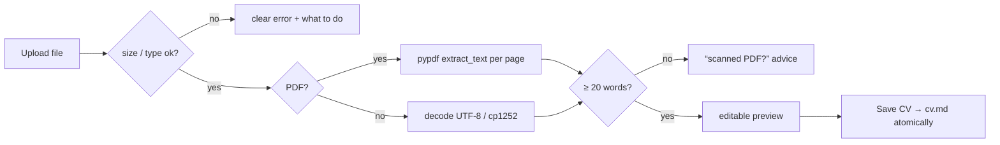

# 22 — File uploads, PDF text extraction, human-in-the-loop correction

## The concept in plain words
- **A file upload is untrusted input.** Check it before using it: size (5 MB cap), type (only
  `.pdf`, `.txt`, `.md`), and readability (corrupt or password-protected PDFs). Then give a message
  that says *what to do*, not just "error".
- **A PDF is not a text file.** It's drawing instructions: "put these glyphs at x,y". `pypdf` rebuilds
  text from the glyphs on each page. Two consequences:
  - layout gets lost (columns, odd spacing), so we tidy whitespace;
  - a **scanned** CV is just an image with no glyphs at all, so extraction returns almost nothing. We
    detect that (fewer than 20 words) and suggest exporting a text-based PDF instead. Reading images
    would need OCR, a heavier tool we don't need here.
- **Text files have encodings.** Modern files are UTF-8, sometimes with a BOM (`utf-8-sig` strips it);
  older Windows files are often cp1252. We try UTF-8 first, then fall back.
- **Human in the loop.** Automatic extraction is *good enough to edit*, not perfect. So the UI shows the
  extracted text in an editable box, and nothing is saved until you click **Save CV**. The same
  principle as the cover letter: the machine drafts, you approve.
- **Atomic save** again (temp file + rename), so the scorer never reads half a CV.

## Why we used it here
- Most people have their CV as a PDF. Upload, check, save takes 30 seconds, and the scorer and
  cover-letter writer pick it up immediately (they read `cv_path` on each run).
- The widget key includes the upload's id, so a new file replaces the text box instead of
  keeping edits from the previous file.

## .NET equivalent
| JobPilot | .NET |
|---|---|
| `st.file_uploader(type=[...])` | `<InputFile accept=".pdf,.txt,.md">` + `IBrowserFile` |
| size / type checks | `file.Size` check, `RequestSizeLimit`, content-type validation |
| `pypdf.PdfReader(...).pages[i].extract_text()` | PdfPig `page.Text` / iText `PdfTextExtractor` |
| `data.decode("utf-8-sig")` then cp1252 | `new StreamReader(stream, detectEncodingFromByteOrderMarks: true)` |
| editable preview before save | a "review" step bound to a textarea, saved only on submit |

## Self-check
1. Why does a scanned PDF give (almost) no text, and what do we tell the user?
2. Why show an editable preview instead of saving the extracted text directly?
3. What's a BOM, and why decode with `utf-8-sig`?
