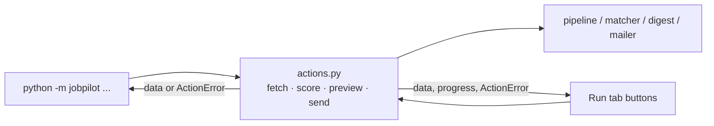

# 23 — One service layer for CLI and UI; long-running work in a UI

## The concept in plain words
- **Service layer**: the *what* (fetch jobs, score, build/send the digest) lives in `actions.py`.
  It returns data and raises `ActionError` with a user-ready message, and it **never prints**.
  The front ends only decide *how to show it*:
  - the CLI prints a table or text and returns exit codes;
  - the Run tab shows buttons, a progress bar and a success or error box.
  One implementation means a bug fixed once is fixed in both places, and the CLI tests keep guarding
  the logic the UI uses.
- **Refactor safely**: we moved code without changing behaviour. The existing CLI tests (output text,
  exit codes, the real-subprocess run) all passed unchanged, which is what proves the refactor safe.
- **Long-running work in a UI**:
  - give feedback: a spinner for unknown duration, a **progress bar** when you know the steps
    (`on_progress(done, total)` callback from the scorer);
  - set expectations: "about 6s per job" (free-tier pacing) beats a silent wait;
  - prevent impossible actions: buttons are **disabled with a hint** until the key, CV or Gmail
    settings exist.
- **Refresh after work**: Streamlit draws the Jobs tab *before* the Run tab's button runs. So after an
  action we store the result in `session_state` and `st.rerun()`: the page redraws with new data and
  the result message survives.

## Why we used it here
- No terminal needed: Settings → Run → Jobs is the whole workflow in the browser.
- Preview renders the digest HTML in the page and sends or marks nothing. Send marks jobs only after
  Gmail accepts the email (build → send → mark, from #15/#16).

## .NET equivalent
| JobPilot | .NET |
|---|---|
| `actions.py` service layer | an application service / MediatR handlers used by both a CLI and a Blazor app |
| `ActionError` with a user message | a `Result<T>` / domain exception mapped to a UI message |
| `on_progress(done, total)` | `IProgress<T>` passed into the service |
| spinner / progress bar | `<MudProgressLinear>` / a Blazor component bound to progress state |
| disabled button + hint | `<button disabled="@(!ready)">` with a tooltip |

## Self-check
1. Why must `actions.py` never call `print()` or `st.*`?
2. What told us the refactor didn't change the CLI's behaviour?
3. Why does the Run tab call `st.rerun()` after a successful fetch?
