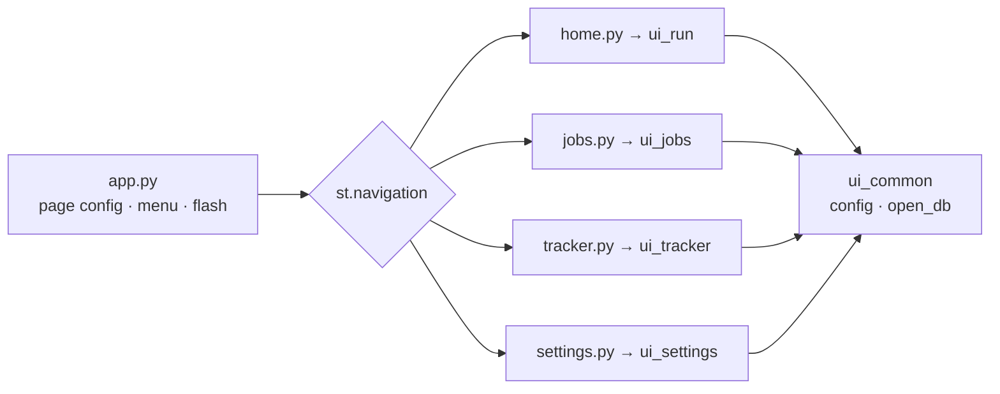

# 24 — Streamlit multipage apps, theming and shared start-up

## The concept in plain words
- **Multipage app**: `app.py` becomes a small *router*. `st.navigation([...st.Page(...)])` builds the
  sidebar menu and returns the page the user picked, and `page.run()` runs just that page's script.
  With tabs, *all* tabs' code ran on every click; now only the visible page runs.
- **Thin pages, fat modules**: `app_pages/jobs.py` is three lines that call `render_jobs(config)`.
  The real code lives in `src/jobpilot/ui_jobs.py`, where it's importable, linted and unit-testable.
  That's the same "UI separate from logic" idea as #8, one level up.
- **Shared start-up**: every page needs config and a database connection. `ui_common.py` gives one
  `load_app_config()` (with a friendly error) and `open_db()`, a *context manager* (`with ... as conn:`)
  that opens, migrates and **always closes** the connection, even when `st.rerun()` interrupts the page.
- **Theming**: Streamlit reads `[theme]` from `.streamlit/config.toml`. One accent colour (indigo) is
  used for buttons, sliders and links. Restraint matters: one brand colour, plus green/amber/red only
  where colour *means* something (scores, coming in #54).
- **Refactor first, redesign second**: this PR moves code **without changing behaviour**. The existing
  tests prove it. The visual redesign comes in #53–#55, on a clean structure.

## .NET equivalent
| Streamlit | ASP.NET Core / Blazor |
|---|---|
| `st.navigation` + `st.Page` | `<NavMenu>` + `@page "/jobs"` routes |
| `app_pages/jobs.py` → `render_jobs()` | a thin `Jobs.razor` page using a component / service |
| `ui_common.open_db()` context manager | a scoped `DbContext` via DI, disposed at the end of the request |
| `.streamlit/config.toml` `[theme]` | CSS variables / MudBlazor theme provider |
| `AppTest.switch_page()` | bUnit rendering a specific page component |

## Self-check
1. With tabs, which code ran when you clicked a button? With pages?
2. Why keep `app_pages/*.py` tiny instead of putting the UI code there?
3. Why is `open_db()` a context manager rather than a plain function returning a connection?
