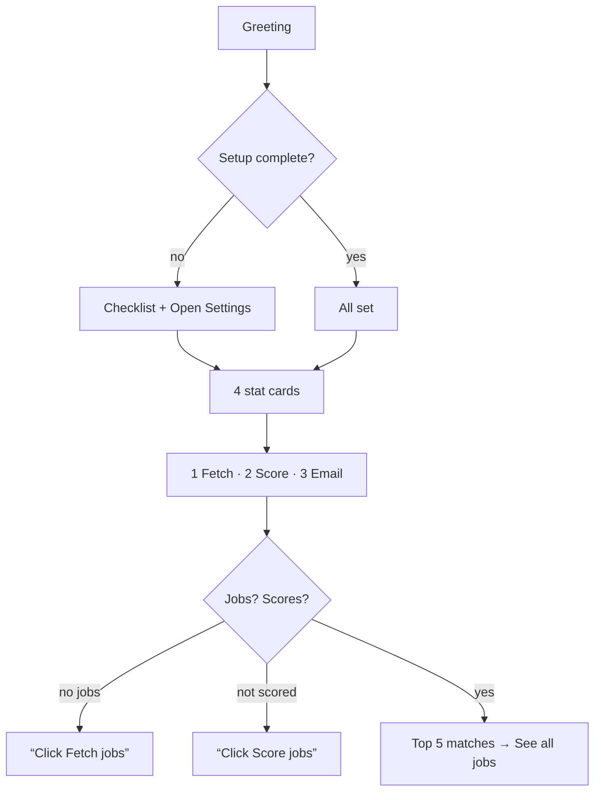

# 25 — Dashboard design, empty states, summarising data

## The concept in plain words
- **A start page answers three questions**, in this order:
  1. *What should I do next?* The **setup checklist** (Gemini ✓, CV ✓, Gmail ○) with one link to
     Settings. It disappears into a single "All set" line once everything's done, because finished
     work shouldn't take up space.
  2. *How is it going?* **Four number cards**: jobs found, scored, strong matches (75+),
     applications. Few, meaningful numbers beat many. Each card has a hover hint explaining it.
  3. *What's worth my time today?* **Top 5 matches**, best first, rejected jobs left out, then a link
     to see all.
- **Empty states** are part of the design, not an afterthought. A blank page tells a new user nothing.
  A good empty state says *why* it's empty and *the one next step*:
  - no jobs → "Click **Fetch jobs** above to get started";
  - jobs but no scores → "Click **Score jobs** to see which ones fit your CV best".
- **Summarising data in pure functions**: `summarize()`, `top_matches()` and `greeting()` take plain
  data and return plain data. The page only draws them, so the counting rules are unit-tested
  without a browser.
- **Group actions as numbered cards** (1 Find → 2 Score → 3 Email). The numbers teach the workflow
  without a manual, and disabled buttons explain what's missing.

## Why we used it here
- A first-time user lands on Home and immediately sees what to set up, then what to click.
- The primary colour goes on the first step's button (**Fetch jobs**). Colour signals "start here".

## .NET equivalent
| JobPilot | .NET / Blazor |
|---|---|
| `summarize()` → `Stats` | a query/service returning a dashboard DTO |
| `st.metric(..., border=True)` | a stat card component (MudBlazor `MudPaper` + text) |
| setup checklist | an onboarding component driven by configuration checks |
| empty-state message | `@if (!jobs.Any()) { <EmptyState .../> }` |
| `st.page_link` | `<NavLink href="/settings">` |

## Self-check
1. What three questions should a start page answer, in what order?
2. What makes an empty state *good*?
3. Why compute the stats in `views.py` instead of inside the Streamlit page?
