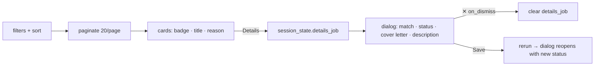

# 26 — Card layouts, dialogs, pagination, colour as information

## The concept in plain words
- **Cards vs tables**: a table is great for *comparing* many columns. A card is great for *deciding*
  about one item. Job hunting is deciding ("is this one for me?"), so each job gets a card: score badge,
  title, company · location, status, the AI's one-line reason, and two actions (**Details**, **Open posting**).
- **Colour as information, never decoration**:
  - **green** 75+ (strong), **orange** 50–74 (fair), **red** below 50 (weak), **grey** not scored;
  - the label repeats the meaning in words ("92 · strong"), so it still works for colour-blind users
    and in screenshots;
  - status badges use a separate palette, and "New" shows no badge to reduce noise.
  All of this lives in `score_badge()`, one tested function, so the rule is the same everywhere.
- **Dialogs** (`@st.dialog`) show details *on top of* the list, so you don't lose your place.
  In Streamlit a dialog only exists while your code calls it on each run, so we remember
  `session_state.details_job`: **Details** sets it, `on_dismiss` (closing with ✕) clears it, and
  after **Save** the dialog reopens showing the new status.
- **Pagination**: 115 cards on one page is slow and overwhelming. `paginate()` returns 20 items, the
  page count, and a page number *clamped* to a valid range, so a stale "page 6" after filtering can't
  break. The page number's key includes the filters, so new filters start at page 1.

## Why we used it here
- On real data: 115 jobs → 6 pages of 20, best match first, a one-click way into the details.
- The table-only helpers (`to_rows`, `resolve_selection`) were deleted with their tests. Removing dead
  code is part of a redesign.

## .NET equivalent
| JobPilot | .NET / Blazor |
|---|---|
| card per job (`st.container(border=True)`) | `MudCard` / a Bootstrap `.card` in a `@foreach` |
| `score_badge()` → (label, colour) | a `ScoreBadge` component with a switch on thresholds |
| `@st.dialog` + `session_state` | `MudDialog` / Bootstrap modal with a selected-item field |
| `paginate(items, page)` | `Skip((page-1)*20).Take(20)` + `MudPagination` |

## Self-check
1. When is a table better than cards, and why did we pick cards here?
2. Why does each score badge also say "strong / fair / weak" in words?
3. Why must the page number be clamped, and when is it reset to 1?
