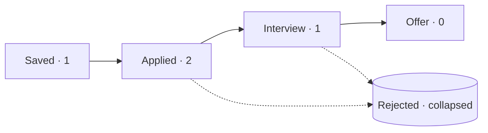

# 27 — Kanban boards and visual consistency

## The concept in plain words
- **A kanban board** shows work as columns, one per stage (Saved → Applied → Interview → Offer).
  Each item is a small card in its column. You see *where everything stands* at a glance, and
  bottlenecks show up as crowded columns ("8 applied, 0 interviews: adjust the CV?").
- **What goes on a small card**: only what helps you act. Title, company, *when* ("applied 3 days
  ago", because relative time is easier to read than a date), the first line of your notes, and one action
  (**Open posting**).
- **Finished items get out of the way**: Rejected is closed work, so it sits in a collapsed section
  with a count. Present, but not taking space from active applications.
- **Empty columns say so** ("Nothing here yet") instead of disappearing, so the board's shape
  stays the same and still teaches the workflow.
- **Visual consistency**: the same meaning always looks the same, on every page:
  - one ✓ / ⚠ helper (`status_icon`) for "set up / missing" on Home *and* Settings;
  - one `notify(kind, text)` so every success, info, warning and error has the same icon;
  - Settings sections all use the same bordered box with a status heading.
  Consistency is mostly *centralising*: one function per visual rule, reused everywhere.

## Why we used it here
- The old Tracker was four tables. The board answers "what's next?" without reading a table.
- `board_columns()` and `ago()` are pure functions: grouping, newest first, NEW excluded, and day
  arithmetic are unit-tested without a browser.

## .NET equivalent
| JobPilot | .NET / Blazor |
|---|---|
| `board_columns()` | LINQ `GroupBy(a => a.Status)` + `OrderByDescending(a => a.UpdatedAt)` |
| `st.columns(4)` with cards | MudBlazor `MudDropContainer` / a CSS grid of cards |
| `ago(when, now)` | Humanizer's `when.Humanize()` |
| `status_icon()` / `notify()` | shared Razor components (`<StatusIcon Ok="..."/>`, a toast service) |
| collapsed "Rejected" | `<MudExpansionPanel>` |

## Self-check
1. What information belongs on a small board card, and what doesn't?
2. Why keep empty columns visible?
3. How does putting icons in `status_icon()` / `notify()` make the UI consistent?
